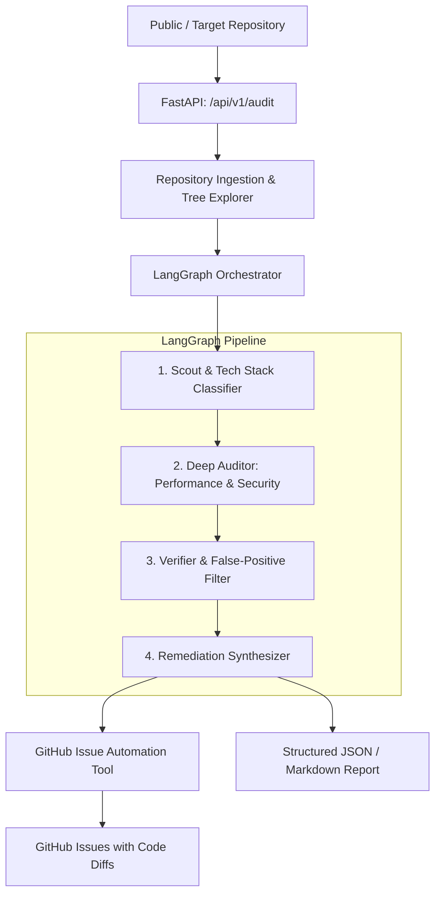

# CodeMate 🛡️⚡
> **Autonomous Repository Auditor** powered by Google Gemini, LangGraph, and FastAPI.

CodeMate is an intelligent code auditing agent that scans public and private repositories for critical **performance bottlenecks** (e.g., ORM N+1 queries, async event loop blocking) and **security vulnerabilities** (e.g., insecure cryptography, hardcoded secrets, injection vectors). 

Instead of noisy hallucinations, CodeMate uses a multi-stage **LangGraph** verification pipeline to confirm findings, synthesize reproduction steps, and automatically open actionable GitHub Issues with before/after code remediation diffs.

---

## 🚀 Key Features

* **Massive Codebase Comprehension**: Leverages Google Gemini's 1M–2M token context window (`gemini-2.0-flash` / `gemini-1.5-pro`) for multi-file semantic reasoning without losing cross-file context.
* **Deterministic LangGraph Pipeline**:
  1. **Scout & Triage**: Analyzes repository structure, dependencies, ORM patterns, and cryptographic primitives.
  2. **Specialized Auditing**: Executes deep rule-guided scans for performance antipatterns and OWASP security flaws.
  3. **Verification Loop**: Evaluates candidate issues against codebase context to eliminate false positives.
  4. **Automated Remediation**: Formats structured findings and files GitHub Issues with reproduction details and code fixes.
* **Target Vulnerabilities & Bottlenecks**:
  * **Performance**: N+1 ORM queries (SQLAlchemy, Django, Prisma), synchronous blocking calls inside async handlers (`time.sleep`, synchronous requests), and resource leaks.
  * **Security**: Deprecated hashing (MD5/SHA-1), insecure AES modes (ECB), weak PRNGs (`random` instead of `secrets`), hardcoded secrets, and injection flaws.
* **Production-Grade API**: FastAPI backend providing asynchronous background audits, status tracking, and report generation.
* **Empirical Benchmarks**: Tested and evaluated against 3 target repositories with known performance and security issues.

---

## 🏗️ Architecture



---

## 🛠️ Tech Stack

* **Core Agent**: [LangGraph](https://github.com/langchain-ai/langgraph) & [LangChain](https://github.com/langchain-ai/langchain)
* **LLM Model**: Google Gemini (`gemini-2.0-flash` / `gemini-1.5-pro`) via `langchain-google-genai`
* **Backend API**: [FastAPI](https://fastapi.tiangolo.com/), Uvicorn, Pydantic v2
* **Git & GitHub Integration**: PyGithub, GitPython
* **Testing & Benchmarking**: Pytest, Rich

---

## ⚙️ Quick Start

### 1. Prerequisites
* Python 3.11+
* [Google Gemini API Key](https://aistudio.google.com/)
* [GitHub Personal Access Token](https://github.com/settings/tokens) (with `repo` permissions to file issues)

### 2. Installation
```bash
# Clone the repository
git clone https://github.com/ali8646/codemate.git
cd codemate

# Create and activate virtual environment
python3 -m venv venv
source venv/bin/activate

# Install dependencies
pip install -r requirements.txt
```

### 3. Environment Configuration
```bash
cp .env.example .env
```
Edit `.env` and configure your API keys:
```env
GEMINI_API_KEY="your-gemini-api-key"
GITHUB_TOKEN="your-github-token"
```

### 4. Run the API Server
```bash
uvicorn app.main:app --reload --port 8000
```
Visit `http://localhost:8000/docs` to view the interactive OpenAPI documentation.

---

## 🧪 Evaluation & Benchmarks
CodeMate is evaluated against 3 benchmark repositories:
1. `benchmarks/fastapi-nplusone`: FastAPI + SQLAlchemy application with deliberate N+1 query patterns.
2. `benchmarks/crypto-insecure`: Python cryptography service with insecure symmetric ciphers and weak hashing.
3. `benchmarks/sample-monolith`: End-to-end repository testbed with mixed security and performance anti-patterns.

---

## 📄 License
MIT License.
