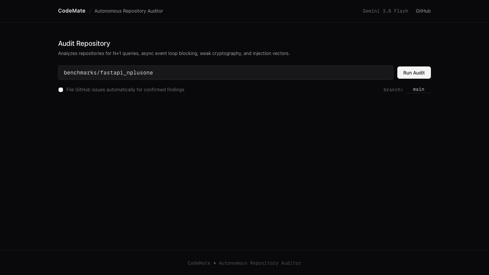
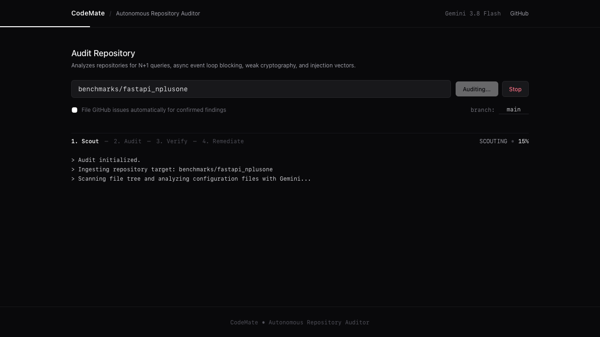
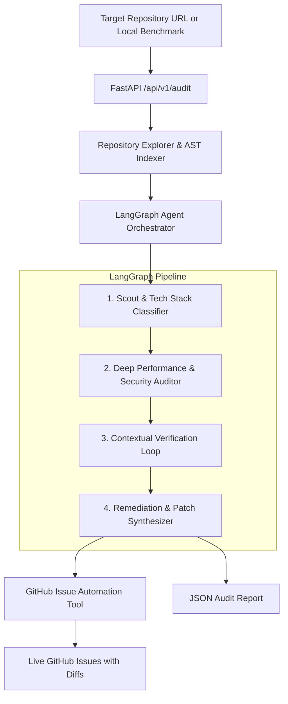

# CodeMate
An autonomous repository auditing engine powered by Google Gemini, LangGraph, and FastAPI.

CodeMate inspects codebases for critical performance bottlenecks (such as ORM N+1 queries and async event loop blocking) and security vulnerabilities (such as weak cryptographic primitives, injection vectors, and hardcoded secrets). 

Using a multi-stage LangGraph verification pipeline, CodeMate validates candidate findings against the surrounding codebase to eliminate false positives, synthesizes reproduction steps, and automatically opens structured GitHub Issues with verified code remediation diffs.

---

## Overview



### The 5 Signature Checks

CodeMate targets five high-signal architectural and security antipatterns:

1. **ORM N+1 Queries**: Identifies database queries executed inside loops over parent records (e.g., SQLAlchemy, Django ORM, Prisma) and generates eager loading (`joinedload`, `selectinload`) patch diffs.
2. **Async Event Loop Blocking**: Flags synchronous blocking calls (`time.sleep()`, synchronous `requests.get()`) executed inside `async def` route handlers in asyncio/FastAPI applications.
3. **Insecure Cryptography & PRNG**: Detects deprecated hashing algorithms (MD5, SHA-1) used for passwords or security tokens, and insecure pseudo-random generators (`random` instead of `secrets`).
4. **Hardcoded Secrets & API Keys**: Flags committed API keys, private keys, and database connection strings in source files.
5. **Injection Vectors**: Identifies raw SQL queries constructed using string concatenation/f-strings, and dangerous dynamic code execution (`eval()`, `exec()`, unsanitized `subprocess.Popen`).

---

## Audit Pipeline & Verified Findings



---

## Architecture

The audit lifecycle is executed as a deterministic LangGraph state machine:



### Execution Stages

1. **Scout Stage**: Clones the target repository into a temporary workspace, analyzes directory structure and dependency files (`requirements.txt`, `pyproject.toml`), classifies the framework and ORM, and selects priority files for deep analysis.
2. **Audit Stage**: Evaluates selected source files against the signature check rules using Google Gemini (1M+ context window).
3. **Verification Stage**: A dedicated verification loop re-inspects candidate issues alongside surrounding file context to filter out false positives and refine code diffs.
4. **Remediation & Dispatch Stage**: Constructs unified before/after patch diffs, calculates repository health metrics, and optionally dispatches issues directly to GitHub via the GitHub REST API.

---

## Tech Stack

* **LLM Engine**: Google Gemini 3.8 Flash via `langchain-google-genai`
* **Agent Framework**: LangGraph & LangChain Core
* **API Backend**: FastAPI, Uvicorn, Pydantic v2
* **Integrations**: PyGithub, GitPython
* **Testing & Evaluation**: Pytest, Playwright

---

## Getting Started

### 1. Prerequisites
* Python 3.9+ (Python 3.11 recommended)
* Google Gemini API Key ([Google AI Studio](https://aistudio.google.com/app/apikey))
* GitHub Personal Access Token (optional, only required if auto-filing GitHub issues)

### 2. Installation
```bash
# Clone repository
git clone https://github.com/ali8646/codemate.git
cd codemate

# Create virtual environment
python3 -m venv .venv
source .venv/bin/activate

# Install dependencies
pip install -r requirements.txt
```

### 3. Configuration
Copy the template environment file and add your credentials:
```bash
cp .env.example .env
```

Edit `.env`:
```env
GEMINI_API_KEY="your-gemini-api-key"
GEMINI_MODEL=gemini-3.8-flash

# Optional: set to allow CodeMate to file GitHub issues
GITHUB_TOKEN="your-github-token"
```

### 4. Run Application
```bash
uvicorn app.main:app --reload --port 8000
```
Open `http://localhost:8000/` in your browser to access the web dashboard, or visit `http://localhost:8000/docs` for interactive OpenAPI documentation.

---

## Evaluation & Benchmarks

CodeMate includes three built-in benchmark testbeds in `benchmarks/` for evaluating detection precision and recall:

| Benchmark Directory | Stack | Injected Issues |
| :--- | :--- | :--- |
| `benchmarks/fastapi_nplusone` | FastAPI + SQLAlchemy | ORM N+1 query loop, blocking synchronous sleep in async endpoint |
| `benchmarks/crypto_insecure` | Python Auth Module | MD5 password hashing, non-cryptographic PRNG for reset tokens |
| `benchmarks/injection_and_secrets` | SQLite / Python | Raw f-string SQL injection, `eval()` expression evaluator, hardcoded API key |

To run an audit on a local benchmark directly from the dashboard, enter its relative path (e.g. `benchmarks/fastapi_nplusone`).

---

## Running Tests

Execute the unit and integration test suite:
```bash
pytest -v
```

---

## License

MIT License. See `LICENSE` for details.
